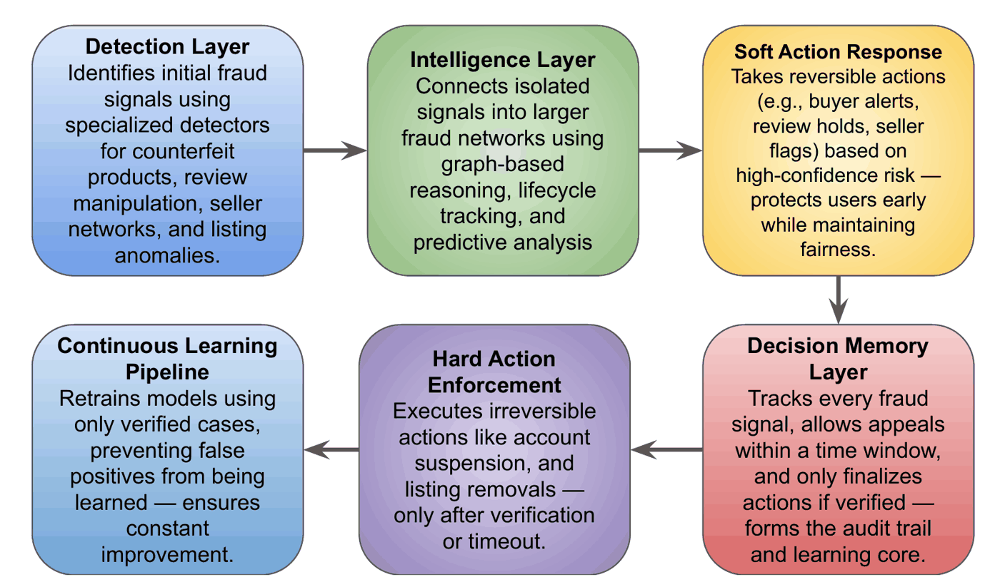

# TrustSight: fraud networks, not just fraudulent listings

**Amazon HackOn 2025 (Season 5) · Team GKG: Yash Sinha and Atharv Warade · top 130 of 52,000+ participants**

Most marketplace fraud checks look at one review or one listing at a time. TrustSight treats every fraud signal as the start of a network investigation: a suspicious review leads to the reviewer's history, the other products they reviewed, those products' sellers and the reviewers they share. Every action it takes is logged in a **Decision Memory Bank**, so decisions can be verified or appealed, and only verified cases are used to retrain the models.



The full pitch, including the per-layer diagrams, is in [`HackON_Submission.pdf`](HackON_Submission.pdf).

## What is in this repository

This is the hackathon prototype as submitted: a Python backend with the detectors and orchestration, and a React storefront (an Amazon-style clone) that shows a trust score on product pages and a fraud dashboard.

| Part | Files | What it does |
|---|---|---|
| Counterfeit detection | `backend/detector.py`, `product_image_analyzer.py`, `logo_verifier.py`, `price_analyzer.py`, `listing_text_analyzer.py` | Seller authority, price deviation, listing text and image checks (CLIP similarity for logos) combined into one counterfeit score |
| Review fraud | `backend/review.py` | Multi-task model: a RoBERTa text encoder plus authenticity, timing, reviewer-behaviour and network heads, fused into one review score |
| Seller networks | `backend/seller.py`, `seller_check.py` | Graph neural network (GCN, PyTorch Geometric) over sellers that share inventory, pricing, registration details or reviewers |
| Listing fraud | `backend/listing.py` | Review–product mismatch, category drift, SEO and variation abuse |
| Cross intelligence | `backend/cross_intelligence.py` | Expands one signal into a network investigation across reviewers, products and sellers |
| Lifecycle + prediction | `backend/lifecycle_predictive.py` | Tracks a product from listing to returns; flags likely review bombs and exit scams |
| Actions + memory | `backend/action_layer.py`, `decision_memory_bank.py` | Reversible "soft" actions first; hard actions only after verification or timeout; every decision recorded for appeals and retraining |
| Orchestration + API | `backend/trustsight_inference_pipeline.py`, `backend/main.py` | Runs the layers in order; FastAPI endpoints for trust scores, seller risk and reports, plus a WebSocket for live fraud alerts |
| Storefront | `Amazon-clone/src/Components/TrustSightDashboard.js`, `TrustSightIndicator.js`, `ProductAnalyzer.js` | Trust score badge on product pages, product analyzer and a fraud dashboard (React, Recharts) |
| Synthetic data | `backend/generate_dataset.py` | Generates 100k synthetic seller profiles (with Faker), legitimate and fraudulent, for the seller-network model |

## Running it

**Backend** (the team used Python 3.9; see `backend/environment.yml`):

```bash
cd backend
pip install -r requirements.txt
python main.py            # FastAPI on http://localhost:8000, docs at /docs
```

**Frontend:**

```bash
cd Amazon-clone
npm install
npm start                 # http://localhost:3000
```

## Status and honest notes

- **Trained weights are not in the repository.** The pipeline expects checkpoints such as `best_model_f1_1.0000.pt` (review model), `seller_network_best_f1_0.5707.pt` (seller GNN) and `models/efficientnet_model.pth`; without them the detectors cannot load. The file names record the validation F1 at save time; a perfect 1.0 usually means the evaluation data was too easy or overlapped with training, so it is not a claim about real reviews.
- **The seller data is synthetic** (`backend/generate_dataset.py`), and the deck's "target performance metrics" are targets, not measured results.
- **The storefront does not build from this repo alone.** It imports `src/Firebase.js` (your own Firebase web config) and images under `src/imgs/`, which were not uploaded. The storefront itself started from an open-source Amazon clone (see `Amazon-clone/README.md`); the TrustSight components were added on top.
- `Amazon-clone/trustsight-backend/mock_api.py` is a stand-in API for the storefront demo; it reads `src/data/products.json` and `src/data/sellers.json`, which are also not in the repo.

## Team

Built in June 2025 for Amazon HackOn by team **GKG**: [Yash Sinha](https://github.com/yashsinha1702) and [Atharv Warade](https://github.com/atharvwarade). This repository is a fork of [atharvwarade/TrustSight-Hackon](https://github.com/atharvwarade/TrustSight-Hackon).
